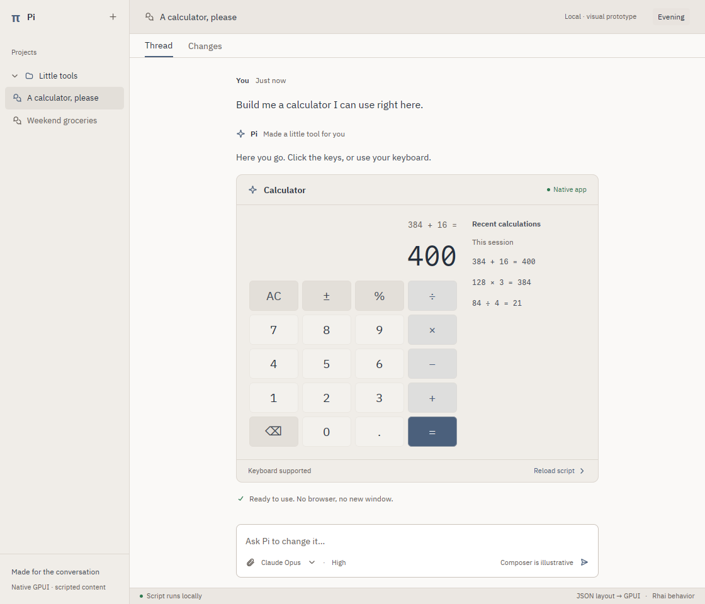

# Historical JSON/Rhai native calculator prototype

**Non-runnable historical material:** the runner, JSON/Rhai sources, captures and separate lockfile below are retained for reference. The shared runtime now requires JavaScript `app.js`; these old `--locked` runner/capture commands do not run with the current runtime. Use the JavaScript calculator fixture in `crates/pi_visual/assets/samples/calculator.pi-visual.js` and `cargo test --locked -p pi_visual` for current native runtime validation.

The original prototype documentation follows; its runtime/validation claims are historical, not current release guarantees.

---

# Scripted native mini-app · calculator

**Real GPUI, not HTML.** A working calculator inside a native conversation-shaped window, with Pi Desktop's shared Moonstone/Evening theme, IBM Plex Sans, Commit Mono and bundled icons. The conversation, sidebar and composer are illustrative. This window is a standalone prototype. Its runtime is now shared by [`pi_visual`](../../crates/pi_visual/README.md), and [Android `@Visualize`](../../crates/pi_android/README.md#native-mini-apps-with-visualize) renders portable bundles directly in chat. Live desktop chat is not integrated.

[Evening screenshot](screens/01-evening.png) · [Moonstone screenshot](screens/02-moonstone.png)



## Run

From the repository root, with the same Rust toolchain and adjacent Zed checkout as Pi Desktop:

```sh
cargo run --locked --manifest-path design/scripted-calculator/native/Cargo.toml
# Or start in Moonstone:
cargo run --locked --manifest-path design/scripted-calculator/native/Cargo.toml -- --light
```

The first build compiles the **runner**. Individual mini-apps don't need a Rust build:

- [`app/ui.json`](app/ui.json) describes columns, rows, styled text bindings and buttons.
- [`app/behavior.rhai`](app/behavior.rhai) implements arithmetic, state transitions and recent calculations.
- The runner loads both files, compiles Rhai to an in-memory AST, and interprets its `dispatch(state, action)` function on interaction. It does not compile native code for the app.
- Change either file and click **Reload script**. The same binary picks up the new UI and behavior. Reload intentionally starts from the new initial state.
- `--app /path/to/app-directory` loads a different app bundle.

Click the keys or type digits, `.`, `+`, `-`, `*`, `/`, `%`, `=`. Enter evaluates, Escape clears, Backspace deletes an editable digit. The theme switch keeps the current calculation intact.

Arithmetic is immediate-execution, like a basic desk calculator: `2 + 3 × 4 = 20`. Percent divides the current operand by 100. Repeated equals is a no-op. Numeric results retain full floating-point precision; rounding is presentation-only. History holds the last three completed calculations.

## What this proves

```text
Generated JSON layout ──────────────→ native GPUI elements
Generated Rhai behavior + state ───→ bounded local script execution
Button click ─→ dispatch ─→ state ─→ updated native display
```

All rendered app controls are GPUI div/text/SVG elements; there is no browser, webview, iframe, JavaScript, subprocess or external agent. The **renderer** isn't calculator-specific: it walks a small declarative node tree. Calculator logic is in the script, not the Rust view.

The prototype uses an explicitly selected set of Rhai arithmetic/string/array/map packages and two pure formatting/finite-check helpers. Modules/imports, runtime `eval`, anonymous functions, function pointers and currying are disabled. It exposes no native filesystem, network, process, GPUI or agent APIs. Calls have an operation budget, nesting/call limits, and bounded strings/containers. UI files, tree depth/node count, button actions and flat primitive state are also validated. Source loading rejects symlinks/non-regular files and caps actual reads at 32 KiB; Unix opens are nonblocking and no-follow to guard replacement races. Failed script calls retain the last valid state and show a host-owned error.

This is **not a production sandbox qualification**. Execution is synchronous, limits are not wall-clock isolation, and accessibility still needs focus/navigation work. The current node vocabulary is only rows, columns, text and buttons. A grocery-list app would also need inputs, repeatable lists and richer state support. The standalone window does not implement session persistence or agent tools. Android uses the shared runtime with native phone layouts and bounded device-local state persistence; bundle changes start fresh rather than migrating state. See [Android verification](../../crates/pi_android/scripts/VISUALIZE_VERIFICATION.md) for tested coverage and limitations.

## Validation

```sh
cargo test --locked -p pi_visual
```

Shared runtime tests cover arithmetic/chaining/precision, entry/sign/percent transitions, division errors and recovery, operation budgets, fixed state schema, disabled eval/imports/host calls, invalid layouts, skipping top-level script execution, rejected function-pointer/currying/anonymous-function syntax, bounded UTF-8 reads and rejection of device symlinks/FIFOs.

To capture **actual native rendering** on Linux/X11 (Xvfb, xdotool, ImageMagick, Tesseract and Python/Pillow):

```sh
cargo build --locked --manifest-path design/scripted-calculator/native/Cargo.toml
bash design/scripted-calculator/capture.sh
```

For a custom build directory, set `CARGO_TARGET_DIR`, or set `PI_CALCULATOR_BINARY` to an existing binary. The capture creates an isolated temporary app bundle, exercises keyboard arithmetic/history and themes, verifies a mouse action updates the display, then edits both JSON and Rhai and confirms the same process reloads them **without invoking a compiler**. Screenshot calculations are real script state, not painted labels. No provider credentials or session data are used.
